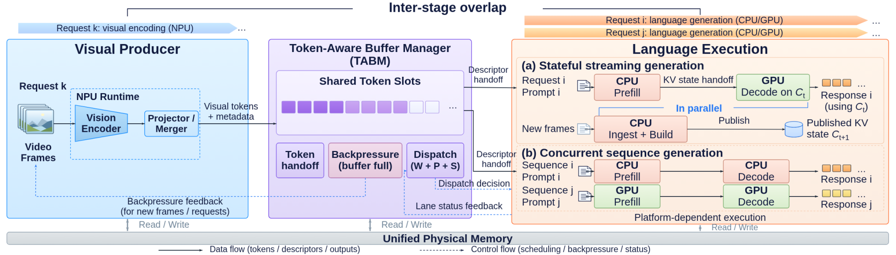
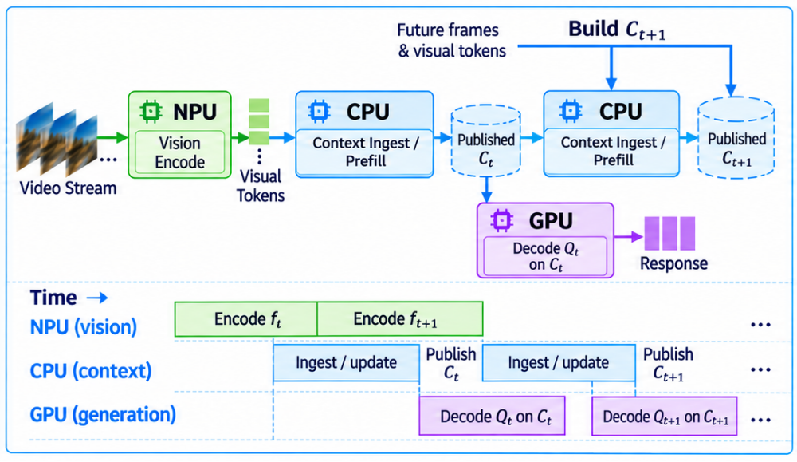
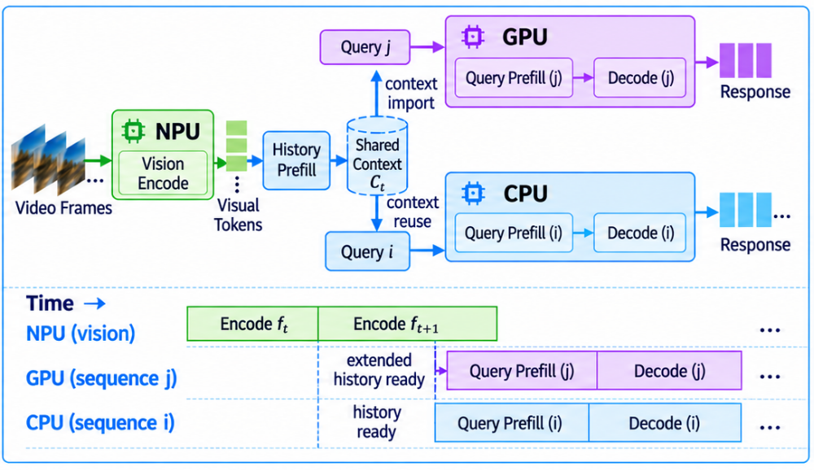
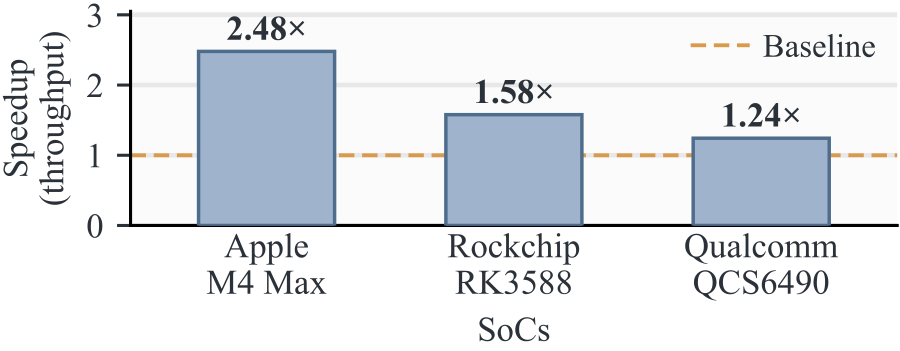
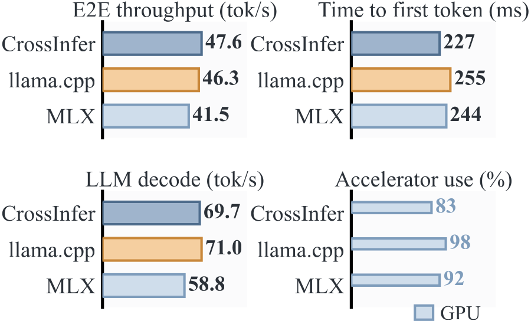
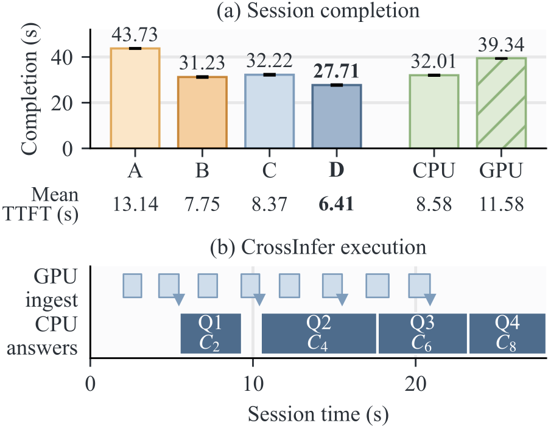
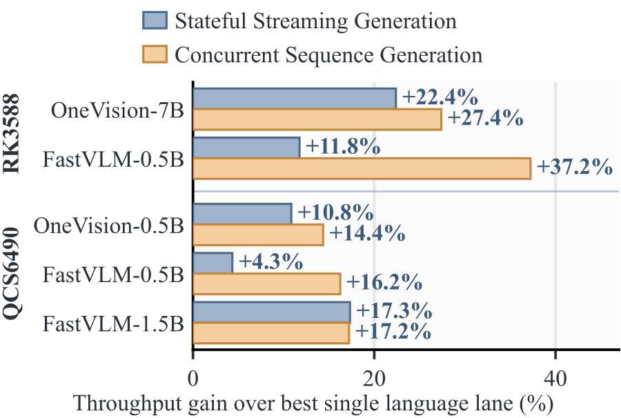
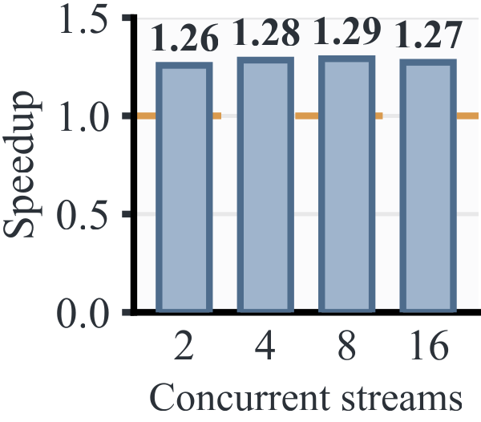
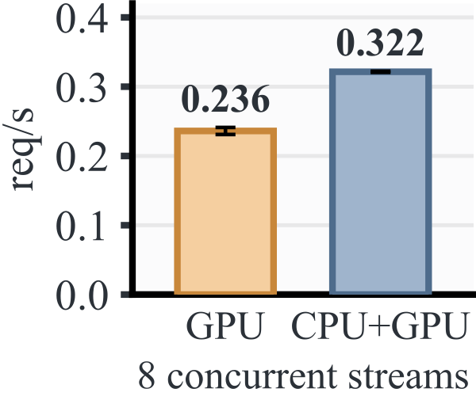
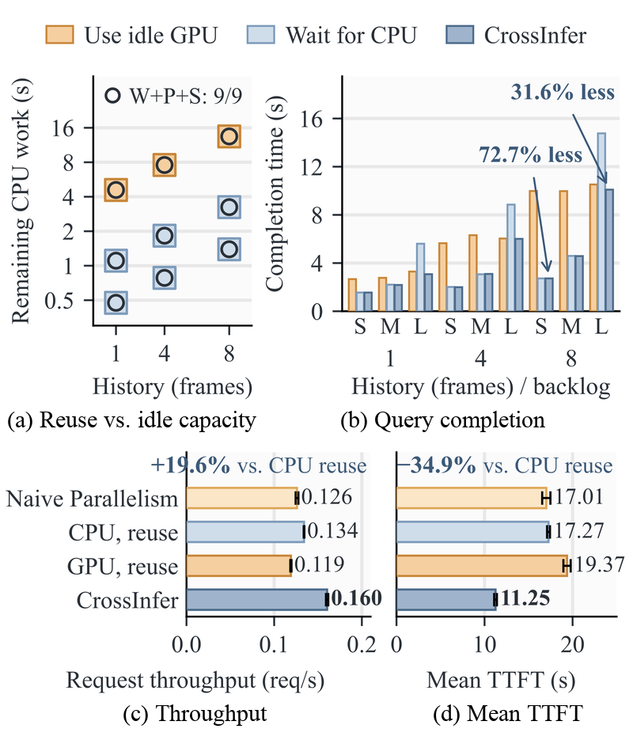

<h1 align="center">Shared Context, Separate Engines:<br>Streaming Vision–Language Inference on Edge SoCs</h1>

<p align="center">
  Yilong Li<sup>1</sup>,
  Chengpo Yan<sup>1</sup>,
  Yijing Zeng<sup>2</sup>,
  Hanlei Wu<sup>3</sup>,
  Mingjun Song<sup>1</sup>,
  Suman Banerjee<sup>1</sup>
</p>

<p align="center">
  <sup>1</sup>University of Wisconsin–Madison &nbsp;&nbsp;
  <sup>2</sup>Meta &nbsp;&nbsp;
  <sup>3</sup>Carnegie Mellon University
</p>

<p align="center">
  <a href="https://arxiv.org/abs/2610.35309"></a>
  <a href="https://arxiv.org/pdf/2610.35309"></a>
  <a href="https://github.com/jimmy-yilong-li/CrossInfer"></a>
  <a href="#citation"></a>
</p>

<p align="center">
  <strong>CrossInfer</strong> runs stateful vision–language model inference concurrently across the CPUs, GPUs, and NPUs of edge SoCs.
</p>

<p align="center">
  <a href="#abstract">Abstract</a> ·
  <a href="#highlights">Highlights</a> ·
  <a href="#how-crossinfer-works">Method</a> ·
  <a href="#main-results">Results</a> ·
  <a href="#platforms-and-models">Platforms</a> ·
  <a href="#reference-source">Source Code</a> ·
  <a href="#citation">Citation</a>
</p>

## 📢 News

<table>
<tr>
<td>

- **[2026-10]** Selected reference components cover Apple Silicon, Qualcomm QCS6490, and shared MNN state management.
- **[2026-10]** The paper preprint is available on [arXiv](https://arxiv.org/abs/2610.35309).

</td>
</tr>
</table>

<p align="center">
  
</p>
<p align="center"><em>
Overview of CrossInfer. (a) <b>Stateful Streaming Generation:</b> one engine ingests new observations while another generates responses from published context, using state handoff. (b) <b>Concurrent Sequence Generation:</b> CPU and GPU execute ready requests in parallel, with state-aware dispatch based on queued work, context preparation, and co-running performance.
</em></p>

## Abstract

Edge SoCs pack CPUs, GPUs, and NPUs, yet vision–language model (VLM) runtimes keep generation on one engine and leave the others idle. Streaming VLMs expose further parallelism: new frames arrive while earlier queries are still being answered. Engines differ in compute and memory access and contend when they co-run, so no single placement of stages wins across SoCs and workloads. Backend-local KV state keeps other engines from continuing the work. CrossInfer coordinates heterogeneous accelerators to execute stateful VLM inference concurrently. It separates a stream's versioned context from each engine's KV state, so any engine can continue the stream by reusing, importing, or reconstructing that state. One engine ingests new frames while another answers (Stateful Streaming Generation), engines serve different ready requests in parallel (Concurrent Sequence Generation), and state-aware dispatch sends each request to the engine expected to finish it first. Each answer reads a fixed, published version of its history, so ingestion never alters it and every answer matches serial execution. CrossInfer beats the strongest single-engine runtimes on Apple M4 Max, Rockchip RK3588, and Qualcomm QCS6490, even when they reuse context, and outperforms parallel engines that do not share state. Continuing from another engine's KV state reaches the first token 4.6× faster than recomputing the prefix, Stateful Streaming Generation delivers up to 2.48× the throughput of serial execution, and state-aware dispatch cuts query completion time by up to 72.7%.

## Highlights

| SoC | Result |
|---|---|
| Apple M4 Max | Stateful Streaming Generation delivers **2.48×** the request throughput of serial execution, with **70.8%** lower mean TTFT |
| Apple M4 Max | A single Qwen2.5-VL-3B request reaches its first token in **227 ms**, versus 244 ms for MLX and 255 ms for llama.cpp |
| Apple M4 Max | Overlapping vision with language execution raises FastVLM-1.5B request throughput by up to **23%** over GPU-only MLX |
| Apple M4 Max | Across Qwen3.5 models from 0.8B to 9B, the same overlap raises request throughput by up to **72.4%** over serial execution |
| Rockchip RK3588 | Stateful Streaming Generation delivers **57.8%** more request throughput than serial execution and up to **42.0%** more than single engines with context reuse |
| Rockchip RK3588 | On two video streams, CrossInfer outperforms two engines without shared state by **27.2%** and the best single engine with context reuse by **19.6%** |
| Rockchip RK3588 | Importing another engine's KV state brings the first token **4.6×** sooner than recomputing the prefix |
| Rockchip RK3588 | Concurrent Sequence Generation delivers **36.3%** more request throughput than GPU-only execution at eight streams |
| Rockchip RK3588 | State-aware dispatch cuts query completion time by up to **72.7%** relative to always using the idle engine |
| RK3588 and Qualcomm QCS6490 | Both execution modes beat the best single engine by up to **37.2%** for OneVision and FastVLM models |
| All three SoCs | Every answer matches its serial execution |

## How CrossInfer Works

- **Versioned context.** A stream's history is a sequence of published context versions *C<sub>t</sub>*. Each query binds one version and keeps private generation state, so ingestion never alters the history an answer reads.
- **Cross-engine state continuation.** Each engine reuses, imports, or reconstructs its own KV representation of a published version. The CPU lane imports GPU-built MNN contexts on RK3588 and QCS6490, and ggml context roots move between CPU and Metal on Apple Silicon.
- **Token interface.** Visual backends hand projected embeddings and model metadata to the language engines at the projector or merger boundary. The token-buffer layer (TABM) manages their identity and lifetime.
- **State-aware dispatch.** Each ready request goes to the engine with the lowest predicted completion time *T = W + P + S*: queued work, context preparation, and co-running service time.

<table>
  <tr>
    <td width="50%"></td>
    <td width="50%"></td>
  </tr>
  <tr>
    <td align="center"><em>(a) Stateful Streaming Generation: the CPU builds C<sub>t+1</sub> while the GPU answers Q<sub>t</sub> from the published C<sub>t</sub>. Engine roles follow each platform's stage costs.</em></td>
    <td align="center"><em>(b) Concurrent Sequence Generation: two lanes answer different queries over C<sub>t</sub>; the CPU reuses it in place and the GPU imports it.</em></td>
  </tr>
</table>

## Main Results

<p align="center">
  
</p>
<p align="center"><em>
CrossInfer's request throughput over serial execution, ingesting new frames on one engine while another answers; every answer matches its serial result. On QCS6490, serial execution already reuses context.
</em></p>

<table>
  <tr>
    <td width="50%" align="center"></td>
    <td width="50%" align="center"></td>
  </tr>
  <tr>
    <td><em><b>Apple M4 Max, single request.</b> FP16 Qwen2.5-VL-3B. CrossInfer uses Core ML on the ANE for vision and ggml on Metal for language; the baselines run on the GPU. CrossInfer reaches the first token in 227 ms and delivers up to 14.9% higher end-to-end throughput.</em></td>
    <td><em><b>RK3588, Stateful Streaming Generation.</b> A–D: neither mechanism, ingestion during generation only, context reuse only, and both (CrossInfer). CrossInfer delivers 57.8% more request throughput than serial execution with 51.3% lower mean TTFT.</em></td>
  </tr>
  <tr>
    <td width="50%" align="center"></td>
    <td width="50%" align="center">
      
      
    </td>
  </tr>
  <tr>
    <td><em><b>Across models and SoCs.</b> Gain of both execution modes over the best single lane, with precomputed visual embeddings on RK3588 and on-device vision on QCS6490.</em></td>
    <td><em><b>Concurrent Sequence Generation.</b> Left: M4 Max speedup over serial execution; the gain reaches 29.1% with more streams. Right: RK3588 CPU and GPU lanes together deliver 36.3% more requests per second than GPU-only at eight streams.</em></td>
  </tr>
</table>

<p align="center">
  
</p>
<p align="center"><em>
State-aware dispatch on RK3588. (a) The faster fixed policy (color) and the W+P+S choice (circle) across nine history/backlog settings. (b) Query completion time under short (S), medium (M), and long (L) backlogs. (c, d) Request throughput and mean TTFT on two concurrent video streams with 112-token answers; error bars show SD. Naive Parallelism runs both lanes without shared state.
</em></p>

## Platforms and Models

| Device (SoC) | Visual encoder | Language lanes | State handoff |
|---|---|---|---|
| Mac Studio (Apple M4 Max) | Core ML on the ANE, or MLX | ggml on CPU and Metal; MLX | ggml context roots, CPU ↔ Metal |
| Orange Pi 5 Ultra (Rockchip RK3588) | RKNN on the NPU | MNN on CPU and OpenCL (Mali-G610) | MNN KV export and import |
| Rubik Pi 3 (Qualcomm QCS6490) | ONNX Runtime QNN on the Hexagon NPU; MNN OpenCL for Qwen2.5-VL | MNN on CPU and OpenCL (Adreno 643) | MNN KV export and import |

The paper evaluates Qwen2.5-VL-3B-Instruct, Qwen3.5 (0.8B–9B), LLaVA-OneVision 0.5B and 7B, and FastVLM 0.5B and 1.5B. Model artifacts and experiment recipes are outside this reference source release.

## Reference Source

This repository provides a selected **reference implementation** of CrossInfer's
runtime components. It is **not a complete reproduction package** for the paper.
The results above describe the research system, not an executable benchmark
suite included here.

| Area | Included components |
|---|---|
| Apple Silicon | Native CPU/Metal sessions, context state and handoff, Core ML surface output, shared-buffer leases, and TABM interfaces |
| Qualcomm QCS6490 | QNN/HTP visual execution adapters and native position handling, using the shared MNN CPU/OpenCL state interfaces |
| Shared runtime | Token buffers, worker protocol, retained contexts, KV state transfer, and reusable scheduling primitives |

Model weights, model conversion and preparation recipes, deployment configurations,
complete application pipelines, evaluation drivers, datasets, and raw experiment
records are not included.

### Source Map

```text
src/edgeflow_split/                Apple session, state, surface and buffer interfaces
tools/edgeflow_llm_runtime/        Native CPU/Metal runtime and bundled llama.cpp/ggml
tools/mac_fastvlm_*                Native language and Core ML surface adapters
crane/                            IOSurface bridge
QCS6490/edgeflow_qcs6490/          Qualcomm visual execution and position support
RK3588/edgeflow_rk3588/runtime/    Shared MNN worker and state-management components
tests/                            Component tests without model assets
assets/                           Figures accompanying this README
```

The shared MNN components retain their original `RK3588` package path for
compatibility; they are also used by the Qualcomm implementation. The
board-specific RKNN visual pipeline is not part of this source subset.

### Using the Components

The native Apple runtime targets macOS with Xcode Command Line Tools and CMake.
Its C API is in
[`edgeflow_llm.h`](tools/edgeflow_llm_runtime/include/edgeflow_llm/edgeflow_llm.h).
The MNN worker requires an external MNN build; the QNN adapter requires a
compatible ONNX Runtime QNN execution provider and device runtime.

The Python modules can be inspected with `src/` and the repository root on
`PYTHONPATH`. The dependency lists cover the included bindings and component
tests, not model export or complete application deployment. Integrating these
components requires caller-supplied model assets and orchestration. Scheduling
costs must be calibrated by the caller; an unspecified prefix-saving estimate
defaults to zero rather than using a bundled device profile.

## Citation

If you find CrossInfer useful in your research, please cite:

```bibtex
@misc{li2026sharedcontext,
  title        = {Shared Context, Separate Engines: Streaming Vision--Language Inference on Edge {SoCs}},
  author       = {Li, Yilong and Yan, Chengpo and Zeng, Yijing and Wu, Hanlei and Song, Mingjun and Banerjee, Suman},
  year         = {2026},
  eprint       = {2610.35309},
  archivePrefix = {arXiv},
  url          = {https://arxiv.org/abs/2610.35309}
}
```

## Acknowledgements

CrossInfer builds on [MNN](https://github.com/alibaba/MNN), [llama.cpp/ggml](https://github.com/ggml-org/llama.cpp), [MLX](https://github.com/ml-explore/mlx), [Core ML Tools](https://github.com/apple/coremltools), [RKNN Toolkit2](https://github.com/airockchip/rknn-toolkit2), and [ONNX Runtime](https://github.com/microsoft/onnxruntime) with the QNN execution provider, and evaluates on [OVO-Bench](https://github.com/JoeLeelyf/OVO-Bench), [MMBench](https://github.com/open-compass/MMBench), MME, and [Video-MME](https://github.com/MME-Benchmarks/Video-MME).
