<p align="center">
  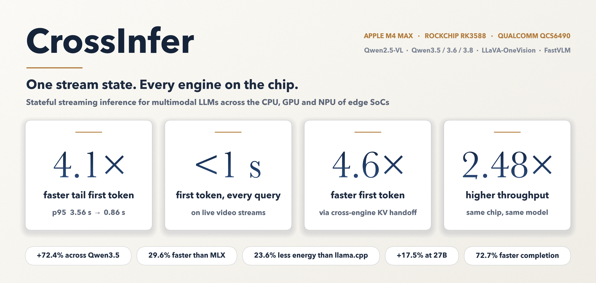
</p>

<h1 align="center">CrossInfer</h1>

<h3 align="center">Shared Context, Separate Engines:<br>Stateful Streaming Inference for Multimodal LLMs on Edge SoCs</h3>

<p align="center">
  Yilong Li<sup>1</sup>,
  Chengpo Yan<sup>1</sup>,
  Yijing Zeng<sup>2</sup>,
  Hanlei Wu<sup>3</sup>,
  Mingjun Song<sup>1</sup>,
  Suman Banerjee<sup>1</sup>
</p>

<p align="center">
  <sup>1</sup>University of Wisconsin–Madison &nbsp;&nbsp;
  <sup>2</sup>Meta &nbsp;&nbsp;
  <sup>3</sup>Carnegie Mellon University
</p>

<p align="center">
  <a href="https://arxiv.org/abs/2610.35309"></a>
  <a href="https://arxiv.org/pdf/2610.35309"></a>
  <a href="https://github.com/jimmy-yilong-li/CrossInfer"></a>
  <a href="#-citation"></a>
</p>

<p align="center">
  
  
  
  
  
  
</p>

<p align="center">
  <b>One stream state. Every engine on the chip.</b><br>
  CrossInfer runs multimodal LLMs on the CPU, GPU and NPU of an edge SoC <i>at the same time</i>:<br>
  <b>4.1× faster tail first tokens · every first token under one second · up to 2.48× throughput</b>
</p>

<p align="center">
  <a href="#-results-at-a-glance">Results</a> ·
  <a href="#-why-crossinfer">Why CrossInfer</a> ·
  <a href="#%EF%B8%8F-how-crossinfer-works">How It Works</a> ·
  <a href="#-more-results">More Results</a> ·
  <a href="#%EF%B8%8F-platforms-and-models">Platforms</a> ·
  <a href="#-quick-start">Quick Start</a> ·
  <a href="#-citation">Citation</a>
</p>

## 🔥 News

- **[2026-11]** 🚀 **27B and counting.** Qwen3.6-27B and Qwen3.8-27B run with **17.5% higher throughput** and **22.8% lower** mean time to first token.
- **[2026-10]** ⚡ **Sub-second first tokens on live video.** SDEP drops p95 time to first token on Apple M4 Max from **3.56 s to 0.86 s**.
- **[2026-10]** 📄 The paper is out on [arXiv](https://arxiv.org/abs/2610.35309).

## 🏆 Results at a Glance

<p align="center">
  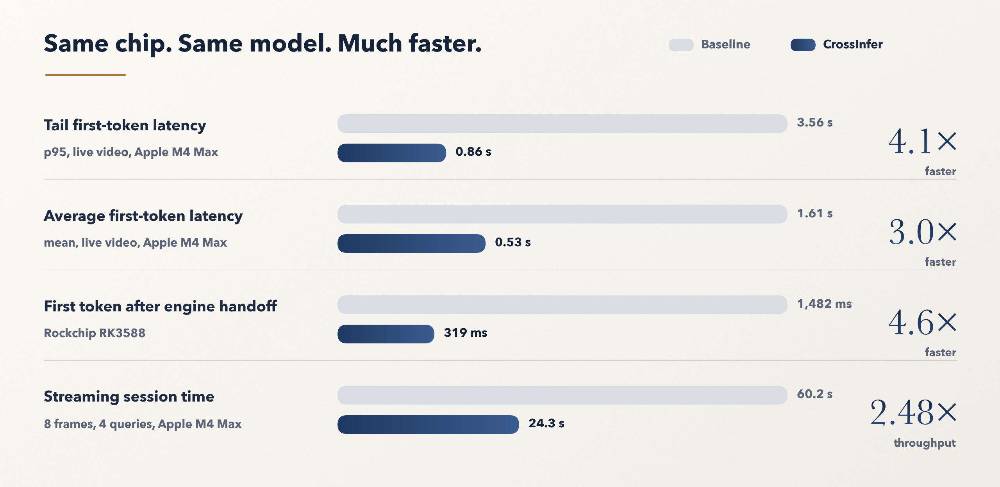
</p>

- ⚡ **4.1× faster** tail first token on live video, and **every first token arrives within one second**
- 🚀 **4.6× faster** first token by continuing from another engine's KV state
- 📈 **2.48×** request throughput and **70.8%** lower mean time to first token on Apple M4 Max
- 🎯 **72.7% faster** query completion with SDEP on Rockchip RK3588
- 🔀 **+52%** request throughput from concurrent sequences on RK3588, and up to **+37.2%** over the best single engine across models
- 🧠 **+72.4%** throughput across Qwen3.5 0.8B–9B, and **+17.5%** on 27B models
- 🥊 **29.6% faster than MLX** on 64-frame video, **23% more throughput than MLX** on FastVLM, and **23.6% less energy than llama.cpp**
- ✅ **Exact outputs:** every answer matches its serial reference, token for token

## 💡 Why CrossInfer

Edge SoCs pack CPUs, GPUs and NPUs, yet today's multimodal LLM runtimes generate on a single engine and leave the rest idle. The blocker is state: the KV cache lives inside one backend, so every query is chained to the engine that built its history.

**CrossInfer breaks that chain.** It separates a stream's history from engine-specific KV state, so any engine can pick up a query, before or after prefill, while the stream keeps flowing. **State-Driven Execution Planning (SDEP)** then decides, live, which engine ingests, which prefills and which decodes.

<details>
<summary><b>📝 Abstract</b></summary>
<br>

Edge SoCs combine CPUs, GPUs, and NPUs, yet runtimes for multimodal large language models (MLLMs) keep generation on one engine and leave others idle. Streaming workloads allow ingestion and answering to overlap, but backend-local KV state binds queries to the engine that built their history. Stage performance and co-running interference vary, so no single placement wins across SoCs and workloads. CrossInfer separates logical history from engine-specific KV state so any language engine can continue a stream. Stateful Streaming Generation overlaps ingestion and answering, while Concurrent Sequence Generation serves ready queries in parallel. Phase-level state continuation lets one engine prefill a query and another decode the answer, freeing the first to resume ingestion. State-Driven Execution Planning (SDEP) chooses paths by predicted completion time and sets each engine's share of queries using arrival rates and measured service times. Across M4 Max, RK3588, and QCS6490, CrossInfer beats the strongest single-engine baselines, even when they reuse context. On M4 Max, SDEP cuts live-stream p95 time to first token by 76%, with every first token within one second, and raises throughput under backlog by up to 35%. On two RK3588 streams, SDEP delivers 19.6% higher request throughput than the best single engine and 27.2% more than parallel engines without shared state. Stateful Streaming Generation reaches up to 2.48× serial throughput on the same engines. Every answer matches its serial reference.

</details>

## ⚙️ How CrossInfer Works

<p align="center">
  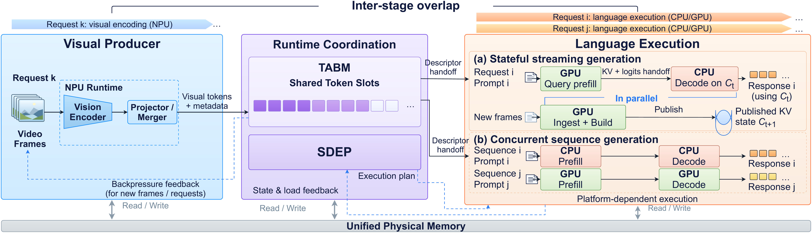
</p>

- 🧬 **Versioned context.** Each query binds a published context version *C<sub>t</sub>* and answers on a private branch, so new frames never disturb an answer in flight.
- 🔁 **Cross-engine state continuation.** Any engine reuses, imports or rebuilds the KV state of a published version: MNN contexts move from GPU to CPU on RK3588 and QCS6490, and ggml contexts move between CPU and Metal on Apple Silicon.
- ✂️ **Phase-level continuation.** Metal prefills a query and hands its KV state, positions and logits to the CPU, which starts decoding at once while Metal returns to ingestion.
- 🧭 **State-Driven Execution Planning.** SDEP picks each query's path by predicted completion time and sizes each engine's share of queries to the arrival rate.
- 🧩 **Zero-copy token interface.** The token buffer (TABM) hands visual tokens to every language engine through shared descriptors.

<table>
  <tr>
    <td width="50%">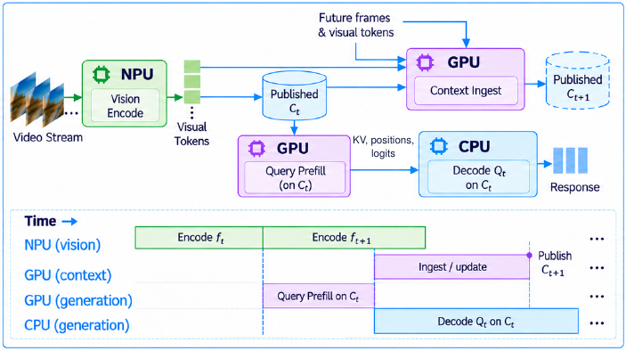</td>
    <td width="50%">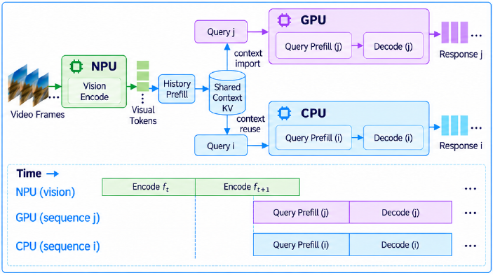</td>
  </tr>
  <tr>
    <td align="center"><em><b>Stateful Streaming Generation.</b> The GPU prefills Q<sub>t</sub> and hands its answer branch to the CPU, which decodes while the GPU builds C<sub>t+1</sub>.</em></td>
    <td align="center"><em><b>Concurrent Sequence Generation.</b> CPU and GPU answer different queries over C<sub>t</sub>: one reuses it in place, the other imports it.</em></td>
  </tr>
</table>

## 📊 More Results

<p align="center">
  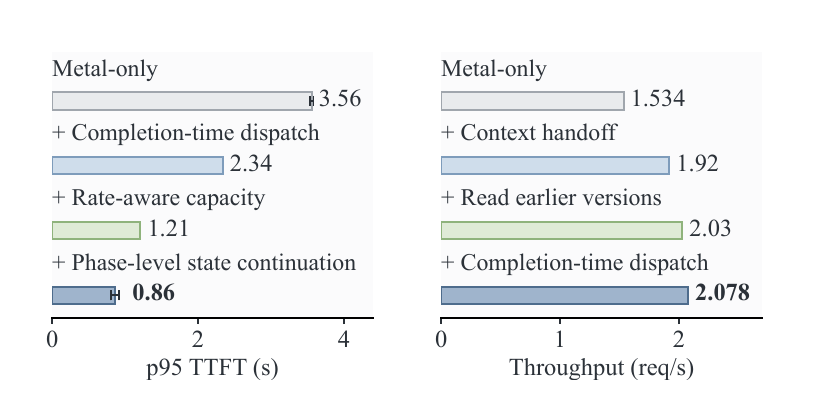
</p>
<p align="center"><b>Every SDEP mechanism stacks up.</b> On a live Apple M4 Max stream, p95 time to first token falls from 3.56 s to 2.34 s, 1.21 s and finally 0.86 s. Under backlog, throughput climbs from 1.53 to 2.08 req/s.</p>

<p align="center">
  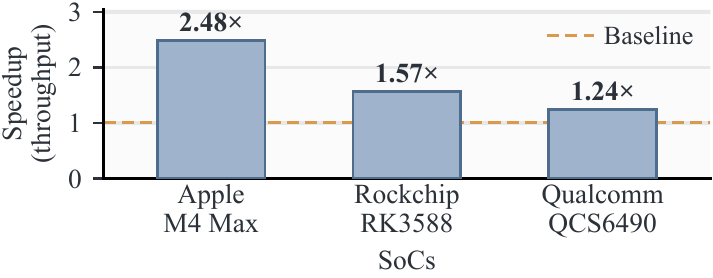
</p>
<p align="center"><b>Stateful Streaming Generation everywhere:</b> 2.48× on Apple M4 Max, 1.57× on Rockchip RK3588 and 1.24× on Qualcomm QCS6490.</p>

<p align="center">
  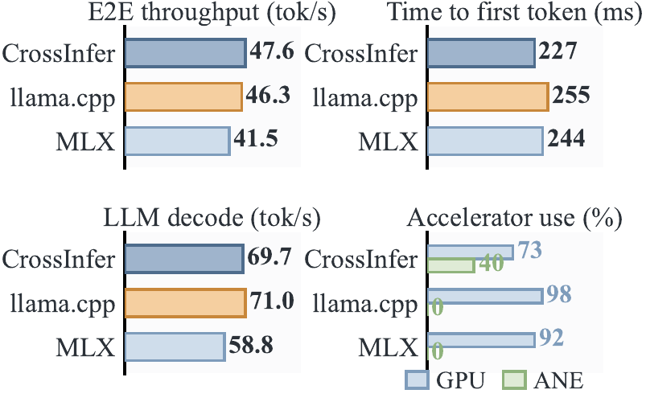
</p>
<p align="center"><b>Faster than MLX and llama.cpp on a single request:</b> first token in 227 ms and up to 14.9% higher end-to-end throughput on Apple M4 Max.</p>

<table>
  <tr>
    <td width="50%" align="center">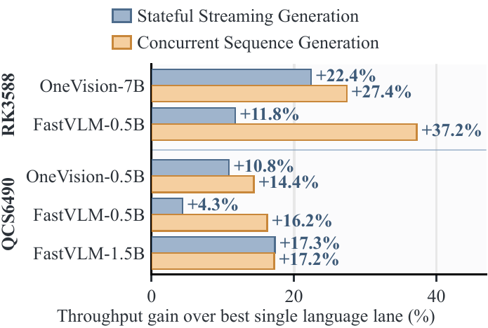</td>
    <td width="50%" align="center">
      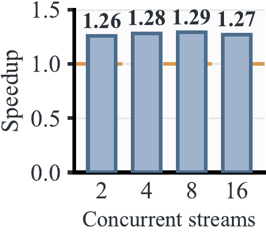
      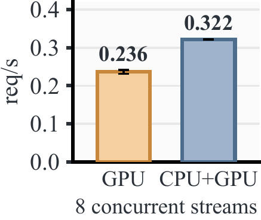
    </td>
  </tr>
  <tr>
    <td align="center"><b>Across models and SoCs:</b> both execution modes beat the best single engine by up to 37.2%.</td>
    <td align="center"><b>More streams, more speed:</b> up to +29.1% on Apple M4 Max and +36.3% at eight streams on RK3588.</td>
  </tr>
</table>

<p align="center">
  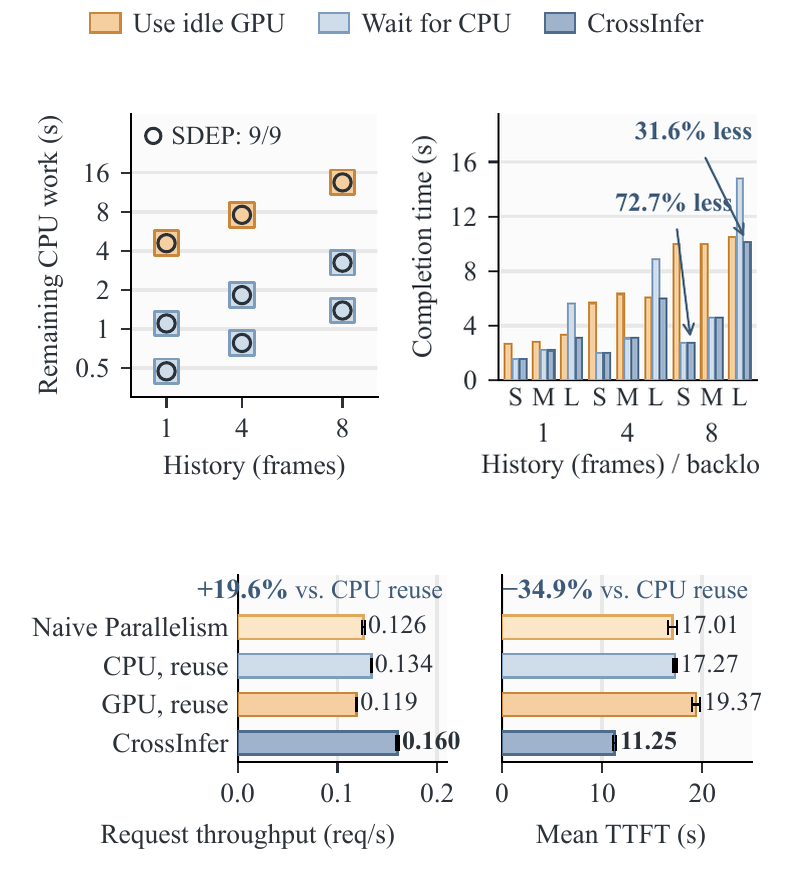
</p>
<p align="center"><b>SDEP always picks the winner:</b> the faster engine in all nine RK3588 settings, 72.7% faster query completion, and 19.6% more throughput with 34.9% lower time to first token on two live streams.</p>

## 🖥️ Platforms and Models

| Device (SoC) | Vision | Language engines | State continuation |
|---|---|---|---|
| Mac Studio (Apple M4 Max) | Core ML on the ANE, or MLX | ggml on CPU and Metal | ✅ CPU ↔ Metal contexts · ✅ Metal → CPU prefilled answers |
| Orange Pi 5 Ultra (Rockchip RK3588) | RKNN on the NPU | MNN on CPU and Mali-G610 | ✅ GPU → CPU KV import |
| Rubik Pi 3 (Qualcomm QCS6490) | ONNX Runtime QNN on the Hexagon NPU | MNN on CPU and Adreno 643 | ✅ GPU → CPU KV import |

**Models evaluated:** Qwen2.5-VL-3B · Qwen3.5 0.8B–9B · Qwen3.6-27B · Qwen3.8-27B · LLaVA-OneVision 0.5B / 7B · FastVLM 0.5B / 1.5B

## 🚀 Quick Start

```bash
# Build the Apple runtime and the IOSurface bridge
make -C crane
cmake -S tools/edgeflow_llm_runtime -B build/runtime -DGGML_NATIVE=ON -DGGML_BLAS=ON -DGGML_BLAS_VENDOR=Apple
cmake --build build/runtime --target edgeflow_llm edgeflow_coreml_surface -j 4

# Stream a video through CrossInfer with SDEP
PYTHONPATH=src:tools:. python tools/evaluate_mac_stream.py \
  --manifest video.json --output run --model model.gguf --hf processor/ \
  --library build/runtime/libedgeflow_llm.dylib \
  --coreml-package visual.mlpackage --surface-library build/runtime/libedgeflow_coreml_surface.dylib
```

## 📦 What's Inside

| Area | Components |
|---|---|
| 🧭 SDEP | Phase-cost projection, engine-progress tracking, rate-aware answering capacity and ingestion placement |
| 🍎 Apple Silicon | Native CPU/Metal sessions, context and prefilled-answer handoff, Core ML surface output, shared-buffer leases and TABM interfaces |
| 📱 Qualcomm QCS6490 | QNN/HTP visual execution adapters and native position handling on the shared MNN state interfaces |
| 🔗 Shared runtime | Token buffers, worker protocol, retained contexts, KV state transfer and reusable scheduling primitives |
| 📏 Evaluation | Retained-history Metal/SDEP comparison, serial references, phase-cost calibration and resource monitoring |

```text
src/edgeflow_split/state_planner.py SDEP projection, progress and rate-aware capacity
src/edgeflow_split/state_costs.py   Phase-cost tables
src/edgeflow_split/                Apple session, state, surface and buffer interfaces
tools/edgeflow_llm_runtime/        Native CPU/Metal runtime and bundled llama.cpp/ggml
tools/mac_fastvlm_*                Native language and Core ML surface adapters
tools/evaluate_mac_stream.py      Retained-history evaluation
tools/run_mac_monitored.py        Memory limits and resource telemetry
crane/                            IOSurface bridge
QCS6490/edgeflow_qcs6490/          Qualcomm visual execution and position support
RK3588/edgeflow_rk3588/runtime/    Shared MNN worker and state management (RK3588 and QCS6490)
tests/                            Component tests
assets/                           Figures for this page
```

<details>
<summary><b>🔬 Reproduce</b></summary>
<br>

**Mac evaluation.** [`tools/evaluate_mac_stream.py`](tools/evaluate_mac_stream.py) compares Metal-only execution with context reuse (**C**) against SDEP (**P**), where Metal prefills each query and the CPU continues decoding. Both arms share the visual backend and input history: Core ML vision writes into IOSurface leases that TABM hands to the language engines. Independent serial runs supply phase costs and token/logit references. Every arm warms all workload shapes and generates the full token budget, and three repeats alternate the C/P order.

**Inputs.** A GGUF language model, its Hugging Face processor, a fixed-grid Core ML visual export, and a manifest such as:

```json
{"stream_id":"video","frames":[{"event_id":"f1","frame":"frames/0001.jpg","arrival_offset_s":0}],"queries":[{"event_id":"q1","question":"Describe the scene.","bound_version":1,"arrival_offset_s":0,"max_response_tokens":128}]}
```

Frame paths are relative to the manifest; add frames and queries to describe a backlog or a timed stream. The evaluation environment uses `numpy`, `Pillow`, `transformers`, `torch`, `torchvision` and `psutil`.

**Qwen3.5-family models.** Add `--model-family qwen35 --visual-metadata export.json` and build the runtime against a compatible llama.cpp source via `EDGEFLOW_LLAMA_ROOT`. `--factors` supplies measured co-running coefficients.

**Outputs.** Receipts include stage timestamps, per-query time to first token and completion latency, output lengths, state transfers, pointer identities and token/logit comparisons; `summary.json` reports each repeat.

**Monitoring.** `tools/run_mac_monitored.py --help` wraps a run with memory limits and CPU/GPU telemetry; use monitor `--output monitored` and child `--output monitored/result`.

**RK3588 and QCS6490.** The MNN worker builds against MNN, and the QNN adapter uses ONNX Runtime with the QNN execution provider. The shared MNN components under `RK3588/` power both boards.

**SDEP core.** [`state_planner.py`](src/edgeflow_split/state_planner.py) takes measured phase costs and co-running factors, and [`rk_stage_planner.py`](RK3588/edgeflow_rk3588/runtime/tabm/rk_stage_planner.py) places ingestion from vision and interference costs. The native C API is in [`edgeflow_llm.h`](tools/edgeflow_llm_runtime/include/edgeflow_llm/edgeflow_llm.h).

</details>

## 📚 Citation

If you find CrossInfer useful in your research, please cite:

```bibtex
@misc{li2026sharedcontext,
  title        = {Shared Context, Separate Engines: Stateful Streaming Inference for Multimodal LLMs on Edge {SoCs}},
  author       = {Li, Yilong and Yan, Chengpo and Zeng, Yijing and Wu, Hanlei and Song, Mingjun and Banerjee, Suman},
  year         = {2026},
  eprint       = {2610.35309},
  archivePrefix = {arXiv},
  url          = {https://arxiv.org/abs/2610.35309}
}
```

## 🙏 Acknowledgements

CrossInfer builds on [MNN](https://github.com/alibaba/MNN), [llama.cpp/ggml](https://github.com/ggml-org/llama.cpp), [MLX](https://github.com/ml-explore/mlx), [Core ML Tools](https://github.com/apple/coremltools), [RKNN Toolkit2](https://github.com/airockchip/rknn-toolkit2), and [ONNX Runtime](https://github.com/microsoft/onnxruntime) with the QNN execution provider, and evaluates on [OVO-Bench](https://github.com/JoeLeelyf/OVO-Bench) and [Video-MME](https://github.com/MME-Benchmarks/Video-MME).
